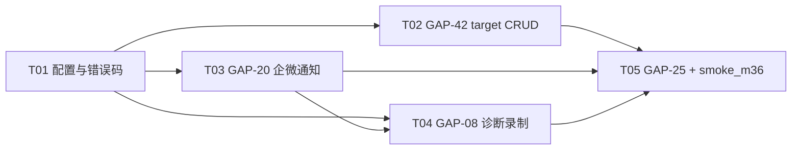

# UI 自动化平台 · M3.6 详细设计：执行目标 CRUD + 企微通知 + 诊断录制 + MySQL 集成测试

> 文档链位置：D0 → D1 → D1a → D2-M1 → D2-M2 → D2-M3 → D2-M3.4 → D2-M3.5 → **D2-M3.6（本文）**
> 批次性质：**增量批次**。只允许新增（新端点 / 新错误码 / 新配置 / 新诊断方法），冻结契约（动作字典 51 条、CAPABILITY_MATRIX、FR28–FR53 与 M3.4/M3.5 冻结项）一律不动。
> 所有"现状"描述已于设计前对照代码核实（pytest 149 passed 基线）。

---

## 1. 批次目标与范围

### 1.1 一句话目标

把四个已登记缺口收敛掉：**执行目标可管理（GAP-42）**、**执行终态自动推企微（GAP-20）**、**trace/video/HAR 失败可回放（GAP-08）**、**MySQL 行为有集成测试兜底（GAP-25，条件项）**。

### 1.2 范围对照

| GAP | 现状（代码依据，已核实） | 本批次交付 | 状态变化 |
|---|---|---|---|
| **GAP-42** | `app/api/v1/projects.py` 仅有 `GET /execution-targets`（第 49 行）；target 只能由 `scaffold_service._ensure_target` / `demo_seed` 创建；`models.ExecutionTarget` **无软删列**（仅 TimestampMixin，无 SoftDeleteMixin/deleted_seq） | 创建 / 详情 / 更新 / 软删 4 个端点 + 路由校验 + 软删唯一键 | ⏸ → ✅ |
| **GAP-20** | `grep 通知/wecom/webhook` = 0；D26 曾决策暂不做，本次放开边界（仅企微机器人一种渠道） | 执行终态 fire-and-forget 推送 + `POST /notifications:test` | ⏸ → ✅（边界收窄见 D33） |
| **GAP-08** | `grep trace/video/har` 在 app/ 下 = 0；Playwright adapter 未开任何录制 | trace（off / on-failure / always）+ video + har，target options 可覆盖全局；产物由执行器落库（kind ∈ {TRACE, VIDEO, HAR}） | ⏸ → ✅ |
| **GAP-25** | `backend/tests/integration/` 目录为空；单测全跑 SQLite，ENUM 退化为 VARCHAR | `test_mysql_schema.py`（UIP_TEST_MYSQL_URL 门控，无库整文件 skip） | ⏸ → ✅（代码就绪、无库跳过） |

### 1.3 批次决策表（Dx 自 D28 顺延）

| # | 决策 | 选定 | 理由 / 倾向 |
|---|---|---|---|
| **D29** | target 删除语义 | **软删**；若被 `project.target_id` 引用 → **置空 `project.target_id`**，返回 204，语义写入文档 | 执行历史存的是 `execution.platform/engine_key/suite_name` 快照，不受影响；不置空会留下悬空引用（`execution_service.submit`、`scan_service` 都会读 `project.target_id`）。**按倾向执行** |
| **D30** | target 同名语义 | 项目内活记录 `name` 唯一；冲突 → **409 `TARGET_NAME_DUPLICATED`**；软删后（`deleted_seq=id`）同名可重建 | 与 `suite_service.delete`（`deleted_seq=suite.id`）完全同款，工程师零新概念 |
| **D31** | target 是否动 schema | **必须动**：`execution_target` 加 `is_deleted` / `deleted_at` / `deleted_seq` 三列 + 唯一键 `uk_target_name(project_id, name, deleted_seq)`；走 Alembic 0002 + 同步 `sql/schema.sql` | D30 的软删重建语义在 MySQL 上必须有 `deleted_seq` 参与唯一键（element / suite 的既有先例）。这是本批次**唯一**的 schema 变更 |
| **D32** | 通知触发策略 | `UIP_NOTIFY_ON ∈ {none, failure, all}`，默认 **failure**（覆盖 FAILED + ERROR）；**CANCELLED 不发**（failure 模式），all 模式全发；webhook 空串 = 全局禁用 | 失败才值得看群消息；手动取消是人为行为，推了反而吵。**按倾向执行** |
| **D33** | 通知边界（D26 部分放开） | 只做**企微群机器人 markdown** 单渠道、全局单 webhook；**不做**：通知渠道管理 UI、per-project webhook、钉钉/Slack、@成员、重试队列 | 最小闭环；D26 其余边界（鉴权/分页/多实例）维持不做 |
| **D34** | 诊断解析实现 | **纯函数** `app/domain/diagnostics.py::resolve_diagnostics(global_trace, global_video, global_har, options) -> DiagnosticsPlan`；不 import settings；非法值回退默认并产出 warning | 与 `domain/scan.py` 同一先例；单测不需要 patch settings |
| **D35** | trace 语义 | 默认 **on-failure**：tracing 从 context 创建即开启（screenshots+snapshots+sources），执行结束按终态决定 `stop(path=trace.zip)` 保存或 `stop()` 丢弃；`always` 恒存；`off` 不开。**CANCELLED 丢弃**（无失败现场价值）。video / har 默认关，开启则全程录制（Playwright 限制，无法按结果取舍） | on-failure 是 Playwright 官方推荐姿势；trace.zip 落盘耗时数秒，恒存会拖慢全绿回归 |
| **D36** | 诊断的适配器接口 | `SessionConfig` **追加字段** `diagnostics_dir: str \| None = None`（additive，默认 None 不影响验证器等旧调用）；`EngineAdapter` 新增**非动作诊断方法** `finalize_diagnostics(*, save_trace: bool) -> None`（默认 no-op，桩适配器零改动，与 probe_locator/scan_dom 同一先例，不进 action_catalog） | 比"把目录塞进 options 魔法键"更显式、可类型检查。**按倾向执行** |
| **D37** | 诊断产物落库时机与归属 | 执行器**两段式**：① `manager.close_all()` **之前**调 `finalize_diagnostics`（trace 必须在 context close 前 stop）；② close 之后**扫描目录**登记 `Artifact(execution_id, step_result_id=None, kind ∈ {TRACE, VIDEO, HAR})` | FR34（只由执行器落库）不可破坏；video 文件由 context close 落盘、文件名随机 → 扫描目录而非记文件名 |
| **D38** | MySQL 集成测试门控 | 环境变量 `UIP_TEST_MYSQL_URL` 存在才跑；驱动用 **pymysql（同步）延迟导入**；DDL 直接执行 `sql/schema.sql`；无库整文件 `pytest.mark.skipif` skip | 本机无 MySQL → "代码就绪、无库跳过"；同步驱动避开 asyncio 复杂度，且 schema.sql 本就是 MySQL 方言 |
| **D39** | 通知失败隔离 | `asyncio.create_task` + `asyncio.wait_for(timeout)` + **全异常吞掉**，只记结构化日志（`event="notify.failed"`），**绝不影响执行结果**；日志**不打印 webhook 完整 URL**（含 secret key） | GAP-20 的硬要求；webhook URL 本身是凭据 |

---

## 2. 各 GAP 设计

### 2.1 GAP-42：execution_target CRUD

#### 现状核对（已对照代码）

- 端点仅 `GET /execution-targets`（`projects.py`，支持 `?project_id=` 过滤），列表项字段：`id/project_id/name/platform/engine_key/base_url/options/enabled`。
- `models.ExecutionTarget`：只有 `TimestampMixin`，**没有** `is_deleted/deleted_at/deleted_seq`；`sql/schema.sql` 的 `execution_target` 表也没有任何 name 唯一键。
- `project_service.targets()` 只过滤 `enabled.is_(True)`；被 `execution_service` / `locator_verify_service` / `scan_service` 间接复用。
- `project.target_id`（无外键，裸 BIGINT）被 5 处读取：submit 校验、execute 取 target、scan 默认目标、verify `_resolve_target`、scaffold `_ensure_target`。

#### 设计

**新增路由（4 个）**，全部收在新文件 `app/api/v1/targets.py`（`projects.py` 保持不动）：

| 方法 | 路径 | 说明 |
|---|---|---|
| POST | `/projects/{project_id}/execution-targets` | 201 创建；项目不存在 404 `PROJECT_NOT_FOUND`；路由不合法复用 422 `PROJECT_PLATFORM_ENGINE_MISMATCH` / 404 `ENGINE_NOT_FOUND` |
| GET | `/execution-targets/{target_id}` | 200 详情；软删或不存在 → 404 `TARGET_NOT_FOUND` |
| PATCH | `/execution-targets/{target_id}` | 200 部分更新（`exclude_unset` 语义，与 `ProjectUpdate` 同款）；`name/platform/engine_key/base_url/options/enabled` 均可选 |
| DELETE | `/execution-targets/{target_id}` | 204 软删（幂等：已删再删返回 404，与 suite 一致） |

`GET /execution-targets` 列表行为不变，但 `project_service.targets()` 增加 `is_deleted.is_(False)` 过滤——execution / verify / scan 的既有调用方自动受益，不需要逐处修改。

**服务层**：新建 `app/services/target_service.py`（依赖 project_service 的风格，不反向依赖）：

- `create(db, project_id, *, name, platform, engine_key, base_url, options, enabled)`
  1. `_project_or_404`（复用 suite_service 同款查询）；
  2. `registry.validate_route(platform, engine_key)`（P1 写入期拦截，**与 project.create 完全同一把尺子**）；
  3. `_assert_name_free(db, project_id, name)` → 活记录同名抛 `TARGET_NAME_DUPLICATED(409)`；
  4. 入库，`deleted_seq=0`。
- `get_or_404(db, target_id)`：`is_deleted.is_(False)`。
- `update(db, target_id, **fields)`：`name` 变更时重跑 `_assert_name_free(exclude_id=self)`；`platform/engine_key` 任一出现即联合重跑 `validate_route`（与 `project_service.update` 同款）。
- `delete(db, target_id)`：
  1. 软删三件套：`is_deleted=True, deleted_at=now, deleted_seq=target.id`（D30，与 suite_service.delete 完全同款）；
  2. **置空引用**：`UPDATE project SET target_id=NULL WHERE target_id=:id AND is_deleted=0`（D29；无论当前是否被引用都执行该 UPDATE，rowcount 不做条件）；
  3. commit；不级联动任何 `execution` 行（历史快照自洽）。

**Schema 变更（D31，唯一一处）**：

- Alembic 迁移 `0002_execution_target_soft_delete`（版本号实现时由 autogenerate 生成）：
  ```sql
  ALTER TABLE execution_target
    ADD COLUMN is_deleted TINYINT(1) NOT NULL DEFAULT 0,
    ADD COLUMN deleted_at DATETIME NULL,
    ADD COLUMN deleted_seq BIGINT NOT NULL DEFAULT 0;
  -- 活记录 (project_id, name) 冲突交给应用层 409 + 语句顺序保证；
  -- 唯一键放三列组合，软删行 deleted_seq=id 互不冲突
  ALTER TABLE execution_target
    ADD UNIQUE KEY uk_target_name (project_id, name, deleted_seq);
  ```
- 同步 `sql/schema.sql` 的 `execution_target` CREATE TABLE（新库直接长出）。
- ORM：`class ExecutionTarget(Base, TimestampMixin, SoftDeleteMixin)` + `deleted_seq` 列 + `__table_args__ = (UniqueConstraint("project_id","name","deleted_seq", name="uk_target_name"),)`（GAP-41 的教训：唯一键必须同时进 ORM，否则 create_all 建的库没有约束）。
- 迁移后必须 `alembic check` 无差异。

**风险兜底**：既有开发库 `backend/data/uitest.db` 由 `alembic upgrade head` 平滑加列，无需重建。

### 2.2 GAP-20：企业微信通知

#### 设计

**新文件 `app/services/notify_service.py`**，四件套：

| 函数 | 职责 | 可测性 |
|---|---|---|
| `build_markdown(payload: dict) -> str` | 拼 markdown 消息体（纯函数） | 不依赖网络 |
| `should_notify(notify_on: str, status: str) -> bool` | D32 门控（纯函数，notify_on 由调用方传） | 表驱动单测 |
| `async send_markdown(webhook, content, timeout_s)` | `httpx.AsyncClient` POST `{"msgtype":"markdown","markdown":{"content":...}}`；HTTP 非 2xx 或响应 `errcode != 0` 都抛 `NotifySendError` | 可指向本地 stub |
| `async notify_execution_result(payload: dict)` | 读 settings 判门控 → `asyncio.create_task(_send_safe(...))`，fire-and-forget；`_send_safe` 内 `asyncio.wait_for` + 全异常吞掉 + `logger.warning(event="notify.failed", ...)` | D39 |

**消息格式**（企微 markdown）：

```
**❌ 执行失败** 冒烟回归
> 来源：用例集「冒烟回归」（无 suite_name 时显示「手动提交」）
> 结果：通过 3 / 失败 1 / 异常 0 / 跳过 0
> 耗时：42.3s
> 执行：#123
> [查看报告](http://host:5173/executions/123/report)
```

- 状态 emoji：PASSED ✅ / FAILED ❌ / ERROR ⚠️（`UIP_NOTIFY_ON=all` 时才可能推这两种之外：CANCELLED ⏹️）。
- 报告链接：`UIP_PUBLIC_BASE_URL` 非空才拼 `{base}/executions/{id}/report`（前端路由，与 ReportView 一致）；为空则整行省略。
- 标题行无 suite_name 时显示「手动提交」。

**挂钩点**：`execution_service.execute()` 末尾——在终态 `db.commit()` 与 `generate_report` 之后调用
`await` 换成 fire-and-forget：`notify_service.notify_execution_result({...})`（内部 create_task，不阻塞 worker）。payload 直接用已算好的 `execution_id / status / suite_name / counts / duration_ms`。

**测试端点**：新文件 `app/api/v1/notifications.py`，注册进 `api/v1/__init__.py`：

| 方法 | 路径 | 成功 | 失败 |
|---|---|---|---|
| POST | `/api/v1/notifications:test` | 200 `{"sent": true, "webhook": "<掩码>"}` | 未配置 webhook → **422 `NOTIFY_NOT_CONFIGURED`**；发送失败（网络异常 / HTTP 非 2xx / `errcode != 0`）→ **502 `NOTIFY_SEND_FAILED`** |

- 请求体可选：`{"content": "..."}`，缺省发固定探测文案「UIP 通知测试消息」。
- webhook 掩码：保留 `https://qyapi.weixin.qq.com/...` 前缀 + key 打码（如 `qyapi.weixin.qq.com/cgi-bin/webhook/send?key=7***x`），避免测试响应泄漏凭据（实现细节：实现时确认掩码格式，要求是"不可还原"）。
- 该端点走**同步等待**（不走 fire-and-forget），调用方需要立即知道成败。

### 2.3 GAP-08：trace / video / HAR

#### 解析层（D34，纯函数）

新文件 `app/domain/diagnostics.py`：

```python
TRACE_MODES = {"off", "on-failure", "always"}

@dataclass(frozen=True)
class DiagnosticsPlan:
    trace: str = "on-failure"      # off / on-failure / always
    video: bool = False
    har: bool = False
    warnings: tuple[str, ...] = ()

def resolve_diagnostics(global_trace: str, global_video: bool, global_har: bool,
                        options: dict) -> DiagnosticsPlan:
    """优先级：target options.trace/video/har > 全局 env；非法值回退 + warning。"""
```

规则：

1. `trace`：options["trace"] 若 ∈ TRACE_MODES 用之；否则用 global_trace；global_trace 也非法 → 回退 `"on-failure"` + warning。options 值非法 → 回退到 global（global 合法时）或默认 + warning。
2. `video` / `har`：options 里的 `video` / `har` 为 bool 时覆盖全局；非 bool（如字符串 "yes"）→ 忽略 + warning（不做真值转换，避免 `"false"` 意外为真）。
3. `warnings` 是字符串元组，执行器写入 `logger.warning`，不进事件流、不影响结果。

#### 适配层（D36）

- `SessionConfig` 追加 `diagnostics_dir: str | None = None`（dataclass 尾部追加默认值字段，frozen/slots 不受影响；`locator_verify_service` 等旧调用点不传即 None）。
- `EngineAdapter.finalize_diagnostics(self, *, save_trace: bool) -> None`：基类 no-op；**不进 action_catalog**（M2 FR19 / M3.5 FR62 诊断方法先例），契约测试只需断言"桩适配器调用它不抛异常"。
- `PlaywrightAdapter`：
  - `start()`：`options` 弹出 `trace/video/har` 的职责**不在适配器**（解析已由执行器做，plan 结论通过 config.options 之外的方式传入？不——适配器从 `config.options` 原样拿）。修正设计：**执行器把解析后的 plan 以三个规范键写回 `SessionConfig.options`**：`options["trace"]=plan.trace, options["video"]=plan.video, options["har"]=plan.har`（规范化后值，适配器只信规范值，非法值已不可能出现）。适配器 `start()`：
    - `trace != "off"` → `context.tracing.start(screenshots=True, snapshots=True, sources=True)`；
    - `video` → `context_opts["record_video_dir"] = {diagnostics_dir}/video`；
    - `har` → `context_opts["record_har_path"] = {diagnostics_dir}/har/execution.har`。
  - `finalize_diagnostics(save_trace)`：trace 已开启时：`save_trace` → `await tracing.stop(path={diagnostics_dir}/trace/trace.zip)`；否则 `await tracing.stop()`（丢弃）。幂等：未开启时直接 return。
  - `stop()` 不改语义（video/har 由 context close 落盘，tracing.stop 必须先于 close —— 由 D37 的两段式保证）。

#### 执行器（D37，`execution_service.execute()` 增量）

```
1. plan = resolve_diagnostics(settings.trace, settings.video, settings.har, target_options)
   # settings.trace/video/har 为 T01 新增配置；target_options = target.options or {}
2. diagnostics_dir = {settings.artifacts_dir}/exec-{execution_id}（mkdirs trace/ video/ har/）
3. SessionConfig(..., options={**target_options, "trace": plan.trace,
                "video": plan.video, "har": plan.har}, diagnostics_dir=diagnostics_dir)
4. 终态判定后、finally 中：
   finally:
       save = (plan.trace == "always")
              or (plan.trace == "on-failure" and status in {"FAILED", "ERROR"})
       # ERROR 但 adapter 没起来时 manager.current 为 None → 跳过 finalize
       if adapter 存在: await adapter.finalize_diagnostics(save_trace=save)
       await manager.close_all()
5. close 之后扫描 diagnostics_dir：
     trace/*.zip → kind=TRACE；video/*.webm → kind=VIDEO；*.har → kind=HAR
     逐个登记 Artifact(execution_id, step_result_id=None, kind, storage="LOCAL",
                       path, size_bytes)   # FR34：只由执行器落库
```

产物访问端点（`GET /executions/{id}/artifacts[/{aid}]`）零改动：`kind` 本就是 VARCHAR(32)，列表/下载/双重校验（FR48）天然覆盖新 kind。trace.zip 下载后可在 trace.playwright.dev 回放——这条写进使用指南，不新做前端页。

### 2.4 GAP-25：MySQL 集成测试（条件项）

新文件 `backend/tests/integration/test_mysql_schema.py`：

- 文件级：`pytestmark = pytest.mark.skipif(not os.environ.get("UIP_TEST_MYSQL_URL"), reason="未配置 UIP_TEST_MYSQL_URL，跳过 MySQL 集成测试")`。
- fixture：延迟 `import pymysql`（未安装则 `pytest.skip("pymysql 未安装")`）；从 `UIP_TEST_MYSQL_URL` 解析连接；**建独立测试库**（`uip_itest_{时间戳}`，用完 DROP）→ 执行 `sql/schema.sql` 全量 DDL（MySQL 方言事实源直接受测）。
- 三条用例（对齐 GAP-25 描述）：

| 用例 | 断言 |
|---|---|
| `test_enum_rejects_invalid_value` | raw `INSERT INTO project (..., platform, ...) VALUES (..., 'X', ...)` → `pytest.raises(pymysql.err.DataError)`（ENUM 拒非法值，SQLite 上永远测不到的行为） |
| `test_bigint_autoincrement_pk` | 连插 2 行 project → id 严格递增且为 int（BigInteger 主键自增） |
| `test_element_softdelete_unique_key` | ① 活记录插同名第 2 条 → `IntegrityError`；② 删（`deleted_seq=id`）后重插同名 → 成功（deleted_seq 修正唯一键模式在真实 MySQL 上成立） |

- 本机无 MySQL：设计保证"代码就绪、无库跳过"（1 skipped），CI/有库环境设环境变量即跑。

---

## 3. 接口契约

### 3.1 新增端点表

| 方法 | 路径 | 入参 | 出参 | 错误码 |
|---|---|---|---|---|
| POST | `/api/v1/projects/{project_id}/execution-targets` | body: `{name*, platform*, engine_key*, base_url?, options?={}, enabled?=true}` | 201 `TargetOut`（字段同现有列表项 + `enabled`） | 404 PROJECT_NOT_FOUND / ENGINE_NOT_FOUND；422 PROJECT_PLATFORM_ENGINE_MISMATCH / VALIDATION_ERROR；409 TARGET_NAME_DUPLICATED |
| GET | `/api/v1/execution-targets/{target_id}` | path | 200 `TargetOut` | 404 TARGET_NOT_FOUND |
| PATCH | `/api/v1/execution-targets/{target_id}` | body: `{name?, platform?, engine_key?, base_url?, options?, enabled?}`（exclude_unset） | 200 `TargetOut` | 404 TARGET_NOT_FOUND；409 TARGET_NAME_DUPLICATED；422 PROJECT_PLATFORM_ENGINE_MISMATCH |
| DELETE | `/api/v1/execution-targets/{target_id}` | path | 204（副作用：`project.target_id` 置空，见 D29） | 404 TARGET_NOT_FOUND |
| POST | `/api/v1/notifications:test` | body 可选 `{content?}` | 200 `{sent: true, webhook: "<掩码>"}` | 422 NOTIFY_NOT_CONFIGURED；502 NOTIFY_SEND_FAILED |

> TargetOut 序列化与现有 `GET /execution-targets` 列表项字段保持一致（`id/project_id/name/platform/engine_key/base_url/options/enabled`），不新增响应字段，前端零适配。
> 路由带冒号的先例：`POST /suites/{id}:run` 已存在，`/notifications:test` 合规。

### 3.2 错误码增量（core/errors.py 新增类 + 同步 ERROR_CODES 汇总）

| code | http | message | 场景 |
|---|---|---|---|
| `TARGET_NOT_FOUND` | 404 | 执行目标不存在 | 详情/更新/删除/软删后访问 |
| `TARGET_NAME_DUPLICATED` | 409 | 项目内已存在同名执行目标 | 创建 / 改名 |
| `NOTIFY_NOT_CONFIGURED` | 422 | 未配置企业微信 webhook（UIP_NOTIFY_WECOM_WEBHOOK 为空） | notifications:test |
| `NOTIFY_SEND_FAILED` | 502 | 通知发送失败 | notifications:test（运行期推送失败不抛，只记日志） |

### 3.3 配置项增量（config.py + .env.example 同步）

| 环境变量 | Settings 字段 | 默认 | 说明 |
|---|---|---|---|
| `UIP_TRACE` | `trace: str = "on-failure"` | on-failure | 全局 trace 模式（off / on-failure / always），D35 |
| `UIP_VIDEO` | `video: bool = False` | false | 全程录屏，D35 |
| `UIP_HAR` | `har: bool = False` | false | 全程 HAR，D35 |
| `UIP_NOTIFY_WECOM_WEBHOOK` | `notify_wecom_webhook: str = ""` | 空=禁用 | 企微群机器人 webhook 完整 URL |
| `UIP_NOTIFY_ON` | `notify_on: str = "failure"` | failure | none / failure（FAILED+ERROR）/ all，D32 |
| `UIP_NOTIFY_TIMEOUT_S` | `notify_timeout_s: float = 5.0` | 5 | 发送超时，D39 |
| `UIP_PUBLIC_BASE_URL` | `public_base_url: str = ""` | 空=消息不带链接 | 对外可访问的平台基址（拼报告链接） |

---

## 4. 测试与验收

### 4.1 单测清单（新增 3 个文件 + 1 个集成文件，预计 +30 条）

| 文件 | 覆盖点 | 数量 |
|---|---|---|
| `tests/unit/test_target_service.py` | 创建（201/路由不合法 422/引擎未注册 404/同名 409/项目 404）、详情 404、更新（改名冲突 409/platform+engine 联合校验/exclude_unset 不动其他字段）、软删（204/再删 404/`project.target_id` 置空/软删后同名可重建/列表不再出现） | ~12 |
| `tests/unit/test_diagnostics.py` | 纯函数：默认值；options 覆盖三类值；options 非法 trace 回退+warning；global 非法回退默认；video="yes" 忽略+warning；video=false 显式关闭覆盖全局 true | ~8 |
| `tests/unit/test_notify_service.py` | `should_notify` 表驱动（none/failure×{PASSED,FAILED,ERROR,CANCELLED}/all）；`build_markdown`（含/无 suite_name、含/无 base_url、emoji 映射）；`notify_execution_result` 未配置不建 task；发送异常被吞且不影响调用方（monkeypatch httpx 抛超时）；test 端点三态（200/422/502，httpx MockTransport） | ~10 |
| `tests/integration/test_mysql_schema.py` | 三条（D38 门控；本机预期 1 skipped） | 3 |

### 4.2 smoke_m36.py 端到端验收步骤

前置：后端 8000 已起（`.env` 打开 `UIP_NOTIFY_WECOM_WEBHOOK` 指向脚本内 stub、`UIP_PUBLIC_BASE_URL=http://127.0.0.1:8000`、`UIP_TRACE=always`、`UIP_VIDEO=true`、`UIP_HAR=true`）、fixtures 8899 已起。

| # | 步骤 | 断言 |
|---|---|---|
| V1 | `POST /projects/{pid}/execution-targets`（name=t36, WEB/playwright） | 201；字段回读一致 |
| V2 | 同名再建；`engine_key=appium` + WEB 再建 | 409 TARGET_NAME_DUPLICATED；422 PROJECT_PLATFORM_ENGINE_MISMATCH |
| V3 | PATCH 改 base_url；GET 详情 | 200 且仅该字段变化 |
| V4 | 设 `project.target_id` 后 DELETE target；GET /projects/{pid} | 204；`target_id` 已为 null |
| V5 | 同名重建 | 201（软删后可重建，D30） |
| V6 | `POST /notifications:test`（stub 校验收到 msgtype=markdown） | 200 sent=true |
| V7 | `.env` 清空 webhook 后 `POST /notifications:test` | 422 NOTIFY_NOT_CONFIGURED |
| V8 | webhook 指向会 500 的 stub 再测 | 502 NOTIFY_SEND_FAILED |
| V9 | 执行一条**失败**用例（suite 或 case，fixture 页面故错定位符） | 终态 FAILED；stub 收到消息含「失败」、计数、执行 ID、报告链接；artifacts 列表出现 TRACE（on-failure 命中） |
| V10 | 执行一条**通过**用例（`UIP_TRACE=always`） | artifacts 含 TRACE + VIDEO + HAR；三者均可 200 下载 |
| V11 | 恢复 `UIP_TRACE=off,UIP_VIDEO=false,UIP_HAR=false` 执行通过用例 | artifacts 无新三类 |
| V12 | 推送失败不影响执行：webhook 指向不监听端口后执行一条**失败**用例（`UIP_NOTIFY_ON=failure` 下通过用例不触发推送，用通过用例会空转） | 执行终态正常落库（FAILED），日志仅 `notify.failed` |

> stub 实现：脚本内起一个 `asyncio` 原生 HTTP 小服务（或 uvicorn 单路由），记录请求体供断言——实现细节实现时确认，不引入新依赖。

### 4.3 回归清单

| 项 | 通过标准 |
|---|---|
| `pytest -q` | ≥ 179 passed（149 + 新增），MySQL 集成为 1 skipped |
| `alembic upgrade head` + `alembic check` | 加列平滑；无差异（No new upgrade operations） |
| `lint-imports` | 2 kept, 0 broken（target_service 不得 import 适配器；diagnostics 在 domain 层零依赖） |
| `smoke_m3.py` / `smoke_m32.py` / `smoke_m35.py` | 17/17、24/24、15/15 |
| `npm run build` | 通过（本批次无前端改动，构建只证不破） |

---

## 5. 有序任务列表（文件级）

> 依赖：T01 是地基；T03 与 T04 都改 `execution_service.py`（挂钩点 vs 执行循环），**按 T03 → T04 串行**避免同文件冲突；T02 完全独立于 T03/T04。

| # | 任务 | 要动/新增文件（完整路径） | 要点 | 依赖 |
|---|---|---|---|---|
| **T01** | 配置与错误码地基 | ① `backend/app/core/config.py`<br>② `backend/.env.example`<br>③ `backend/app/core/errors.py` | config 新增 7 字段（§3.3 表，含注释）；.env.example 补同名条目与注释；errors.py 新增 4 个错误类（§3.2）**并同步 ERROR_CODES 汇总元组** | — |
| **T02** | GAP-42 执行目标 CRUD | ① `backend/app/models/__init__.py`<br>② `backend/alembic/versions/0002_execution_target_soft_delete.py`（新）<br>③ `backend/sql/schema.sql`<br>④ `backend/app/schemas/requests.py`<br>⑤ `backend/app/services/target_service.py`（新）<br>⑥ `backend/app/services/project_service.py`<br>⑦ `backend/app/api/v1/targets.py`（新）<br>⑧ `backend/app/api/v1/__init__.py`<br>⑨ `backend/tests/unit/test_target_service.py`（新） | ORM 加 SoftDeleteMixin+deleted_seq+uk_target_name；迁移 0002（upgrade/downgrade 成对）；schema.sql 同步；TargetCreate/TargetUpdate；service 四方法（D29/D30）；targets() 加 is_deleted 过滤；4 端点 + 注册；单测 ~12 条；`alembic check` 必须无差异 | T01 |
| **T03** | GAP-20 企微通知 | ① `backend/app/services/notify_service.py`（新）<br>② `backend/app/api/v1/notifications.py`（新）<br>③ `backend/app/api/v1/__init__.py`<br>④ `backend/app/services/execution_service.py`<br>⑤ `backend/tests/unit/test_notify_service.py`（新） | notify_service 四件套（D32/D39，httpx 已在 requirements）；execution_service 终态 commit 后一行挂钩（fire-and-forget，绝不 await 抛错）；test 端点三态 + webhook 掩码；单测 ~10 条 | T01 |
| **T04** | GAP-08 trace/video/HAR | ① `backend/app/domain/diagnostics.py`（新）<br>② `backend/app/engines/base.py`<br>③ `backend/app/engines/adapters/playwright_adapter.py`<br>④ `backend/app/services/execution_service.py`<br>⑤ `backend/tests/unit/test_diagnostics.py`（新） | 纯函数 resolve_diagnostics（D34）；SessionConfig 加 diagnostics_dir；EngineAdapter.finalize_diagnostics（no-op 基类，不进 action_catalog）；Playwright start 开 tracing/record_video/har + finalize 两分支；执行器两段式（D37：finalize→close→扫描落库 kind=TRACE/VIDEO/HAR，step_result_id=None）；单测 ~8 条 | T01, T03（串行合并 execution_service.py） |
| **T05** | GAP-25 集成测试 + 端到端验收 | ① `backend/tests/integration/test_mysql_schema.py`（新）<br>② `backend/requirements-dev.txt`（补 pymysql 可选依赖注释）<br>③ `scripts/smoke_m36.py`（新） | 三条 MySQL 用例 + UIP_TEST_MYSQL_URL 门控（D38）；smoke 按 §4.2 V1–V12 全走通 | T02, T03, T04 |

### 依赖图



---

## 6. 风险与回滚

| # | 风险 | 影响 | 缓解 / 回滚 |
|---|---|---|---|
| R1 | Alembic 0002 与 ORM/schema.sql 三处不一致 | `alembic check` 报差异，重蹈 GAP-41 | 迁移、ORM `__table_args__`、schema.sql 同一任务（T02）内完成并当场跑 `alembic check`；回滚：`alembic downgrade -1`（列无数据语义，可逆） |
| R2 | `tracing.stop()` 在大页面/长执行时耗时数秒 | 执行收尾变慢 | stop 在 worker 内执行，不占用 API 线程；`always` 模式的代价已写入 D35 文档；不做（实测超 10s 再议异步化） |
| R3 | video 文件过大撑爆磁盘 | artifacts 目录膨胀 | 默认关（UIP_VIDEO=false）；目录按 `exec-{id}` 组织，可整目录删；文档注明"video 不受执行结果取舍" |
| R4 | webhook URL（含 key）泄漏到日志/响应 | 凭据泄露 | D39：日志只打事件与状态码；test 端点响应掩码（T03 单测覆盖） |
| R5 | 通知/录制异常影响执行结果 | 破坏"绝不影响执行"红线 | D39 fire-and-forget + 全异常吞掉；finalize/close_all 各自 try-except（沿用 stop 现有防御式写法）；smoke V12 专项验证 |
| R6 | `project.target_id` 置空影响 scan/verify | 依赖默认目标的调用方行为变化 | 这正是预期语义（默认目标已删）；受影响调用方均已按 `target_id=None` 分支兜底（`_resolve_target` 返回 None → 要求显式传 url/target_id，422 提示） |
| R7 | MySQL 集成测试在有库环境才暴露 schema.sql 错误 | 本机假绿 | 设计上 DDL 直接执行 `sql/schema.sql` 事实源；三条用例对准三个最易错点（ENUM/自增/软删唯一键） |
| R8 | 整批回滚 | — | 代码回滚 + `alembic downgrade -1` + `.env` 清空新增项即回到 M3.5 行为；无数据不可逆操作 |

---

## 7. 建议冻结项（验收通过后生效，编号自 FR54 顺延，收尾批次确认）

| # | 内容 |
|---|---|
| FR54 | `execution_target` 软删三列 + `uk_target_name(project_id, name, deleted_seq)`；删除置空 `project.target_id`，响应 204 |
| FR55 | 通知只走企微群机器人单渠道、全局单 webhook；`UIP_NOTIFY_ON` 门控；推送 fire-and-forget 且绝不影响执行结果（D33/D39） |
| FR56 | 诊断解析是纯函数（domain/diagnostics），target options > 全局 env；非法值回退默认 + warning |
| FR57 | trace/video/HAR 产物 kind ∈ {TRACE, VIDEO, HAR}、只由执行器落库、`step_result_id=NULL`；trace 目录 `{artifacts_dir}/exec-{id}/` |
| FR58 | `finalize_diagnostics` 是诊断方法不进 action_catalog；桩适配器默认 no-op |

---

## 变更记录

| # | 日期 | 条目 | 依据 |
|---|---|---|---|
| 1 | 2026-10-19 | v1.0 初稿：D29–D39、§2 四个 GAP 设计、§3 契约、§5 五任务分解 | 用户确认的 M3.6 范围；《待办与缺口跟踪》GAP-42/20/08/25；代码核实（projects.py / models / execution_service / suite_service / playwright_adapter / schema.sql） |
| 2 | 2026-10-19 | M3.6 实现完成：T01–T05 全部落地，pytest 197 passed + 1 skipped、lint-imports 2 kept、alembic check 无差异 | 见下「实现记录」 |

---

## 实现记录

### 文件清单

**T01 配置与错误码地基**

| 文件 | 操作 | 说明 |
|---|---|---|
| `backend/app/core/config.py` | 修改 | 新增 7 个配置：trace / video / har / notify_wecom_webhook / notify_on / notify_timeout_s / public_base_url（§3.3 表，含中文注释） |
| `backend/.env.example` | 修改 | 同步 7 个环境变量条目与注释 |
| `backend/app/core/errors.py` | 修改 | 新增 TargetNotFound(404) / TargetNameDuplicated(409) / NotifyNotConfigured(422) / NotifySendFailed(502) 四个错误类，并同步底部 ERROR_CODES 汇总 |

**T02 GAP-42 执行目标 CRUD**

| 文件 | 操作 | 说明 |
|---|---|---|
| `backend/app/models/__init__.py` | 修改 | ExecutionTarget 加 SoftDeleteMixin + deleted_seq + `__table_args__`（uk_target_name 三列唯一键 + idx_target_project 组合索引，GAP-41 教训同步进 ORM） |
| `backend/alembic/versions/0002_execution_target_soft_delete.py` | 新增 | 本批唯一 schema 变更：软删三列 + 唯一键 + 索引，batch_alter_table 兼容 SQLite，upgrade/downgrade 成对 |
| `backend/sql/schema.sql` | 修改 | execution_target CREATE TABLE 同步加列/唯一键/索引 |
| `backend/app/schemas/requests.py` | 修改 | 新增 TargetCreate / TargetUpdate（exclude_unset 语义） |
| `backend/app/services/target_service.py` | 新增 | create / get_or_404 / update / delete 四方法（D29 置空 project.target_id、D30 软删 deleted_seq=id、registry.validate_route 写入期校验） |
| `backend/app/services/project_service.py` | 修改 | targets() 加 `is_deleted.is_(False)` 过滤（一处改动，execution/verify/scan/scaffold 四调用方自动受益） |
| `backend/app/api/v1/targets.py` | 新增 | 四端点：POST /projects/{id}/execution-targets、GET/PATCH/DELETE /execution-targets/{id} |
| `backend/app/api/v1/__init__.py` | 修改 | 注册 targets、notifications 两个新 router |
| `backend/tests/unit/test_target_service.py` | 新增 | 15 条：创建/409/404/422/详情/更新/软删重建/引用置空/列表过滤 |

**T03 GAP-20 企微通知**

| 文件 | 操作 | 说明 |
|---|---|---|
| `backend/app/services/notify_service.py` | 新增 | 四件套 build_markdown / should_notify / send_markdown(httpx) / notify_execution_result（create_task + wait_for + 全异常吞掉，event=notify.failed，日志不含 webhook URL）+ mask_webhook |
| `backend/app/api/v1/notifications.py` | 新增 | POST /notifications:test：未配置 422 / 发送失败 502 / 成功 200 + webhook 掩码 |
| `backend/app/services/execution_service.py` | 修改 | 终态 commit + generate_report 之后挂钩通知（fire-and-forget） |
| `backend/tests/unit/test_notify_service.py` | 新增 | 14 条：门控表驱动 / markdown / 掩码 / 未配置不建 task / 异常吞掉 / 端点三态 |

**T04 GAP-08 trace/video/HAR**

| 文件 | 操作 | 说明 |
|---|---|---|
| `backend/app/domain/diagnostics.py` | 新增 | 纯函数 resolve_diagnostics + DiagnosticsPlan（不 import settings；options > env；非法值回退 + warning；video/har 非 bool 忽略） |
| `backend/app/engines/base.py` | 修改 | SessionConfig 追加 diagnostics_dir 字段；EngineAdapter.finalize_diagnostics 基类 no-op（不进 action_catalog） |
| `backend/app/engines/adapters/playwright_adapter.py` | 修改 | start 开 tracing/record_video_dir/record_har_path（仅当 diagnostics_dir 存在，防止验证器/扫描悬空 tracing）；finalize 两分支（stop(path) / stop() 丢弃，异常吞掉） |
| `backend/app/services/execution_service.py` | 修改 | 两段式：resolve → mkdir exec-{id} 三子目录 → 规范键写回 options；finally 中 finalize（manager.current 判空）→ close_all；close 后扫描目录登记 Artifact(kind=TRACE/VIDEO/HAR, step_result_id=None) |
| `backend/tests/unit/test_diagnostics.py` | 新增 | 8 条：默认值 / 覆盖 / 非法回退 / 非 bool 忽略 / 51 条字典红线 |
| `backend/tests/unit/test_stub_adapter.py` | 修改 | 补 1 条契约：桩适配器 finalize_diagnostics no-op 不抛（FR58） |

**T05 GAP-25 + 端到端**

| 文件 | 操作 | 说明 |
|---|---|---|
| `backend/tests/integration/test_mysql_schema.py` | 新增 | UIP_TEST_MYSQL_URL 门控（模块级 skip，无库 1 skipped）；pymysql 延迟导入；建独立测试库执行 sql/schema.sql 用完 DROP；三条用例（ENUM 拒非法值 DataError / BigInteger 自增 / element 软删唯一键） |
| `backend/requirements-dev.txt` | 修改 | 补 pymysql 可选依赖注释 |
| `scripts/smoke_m36.py` | 新增 | 按 §4.2 V1–V12 五阶段（full / off / bad / offdiag / nostub），内置 asyncio 原生 webhook stub（ok/500 两模式） |

### 与设计的偏差点

1. **notify_execution_result 的调用形态**：设计表写 `async notify_execution_result`，实现为 async 函数、内部 `asyncio.create_task(_send_safe(...))`，挂钩处 `await notify_service.notify_execution_result(...)` 只等待"是否建任务"的门控同步逻辑，推送本体 fire-and-forget——与"调用方绝不 await 其内部异常"的语义一致（§2.2 文字"换成 fire-and-forget"的直译不 await 会导致协程永不执行，取语义正确解）。
2. **Playwright 适配器录制门控**：设计未明确旧调用点（验证器/扫描）复用 target options 时的行为；实现为**仅当 `SessionConfig.diagnostics_dir` 非空才开 tracing/录制**，避免"开了 tracing 却永远没人 stop"的悬空状态（D36 的 diagnostics_dir 字段恰好提供该判据）。
3. **MySQL skip 数**：设计 §4.3 写"1 skipped"；实现为模块级 `pytest.skip(allow_module_level=True)`，实际 1 skipped，与设计一致（曾先按逐用例 skipif 实现为 3 skipped，已改为整文件跳过）。
4. **ORM/schema 同步补索引**：设计只提唯一键 `uk_target_name`；实现把 `idx_target_project(project_id, is_deleted)` 同步进 ORM + 迁移 + schema.sql 三处（GAP-41 教训的完整版）。
5. **smoke_m36 未在本机执行**：按任务约束（8000/5173/8899 不启动），脚本已就绪待 QA 阶段统一重启后跑五个 phase。

### 测试结果数字

| 项 | 结果 |
|---|---|
| `pytest -q` | **197 passed, 1 skipped**（基线 149 + 新增 48；skip 为 MySQL 集成测试整文件门控） |
| `lint-imports` | **2 kept, 0 broken** |
| `alembic upgrade head` | 2f2753e09b0f → a3f6c8d21e47 平滑加列成功 |
| `alembic check` | **No new upgrade operations detected.** |
| 冻结红线自查 | 动作字典仍 51 条（test_diagnostics 断言）；新增 4 错误码已进 ERROR_CODES 汇总；targets/notifications router 均已注册 |
| smoke_m36.py | 已交付未执行（服务器未启动，QA 阶段按五 phase 跑） |

### QA 收尾修正

- QA 验收全绿（ROUTE: NoOne）；QA 修正了 smoke_m36.py V6 的掩码断言（改为「含 `***` 且不等于完整 URL」，复跑 22/22 通过）。
- 工程师修正 target_service.py update 的注释与实现对齐：显式传 null 被忽略（与 project_service.update 语义一致），base_url 不支持置空、如需变更请直接传新值；test_target_service.py 复跑 14 passed。

### 验收审计修正（2026-10-20 23:50）

**竞态缺陷（验收审计实测命中）**：`execution_service.run()` 原顺序为「终态 commit（§run 尾部）→ `_register_diagnostics`」，轮询者会在终态可见后 0~1s 内查到不完整的产物列表（full 阶段 V10 首跑失败：只见部分 kind）。
**修复**：`_register_diagnostics` 移至终态 commit **之前**（其内部 commit 会将终态与产物一并落库），并加 try/except 保证登记失败不影响执行结果。修复后 full 阶段连跑两次 **22/22**，`pytest` 206 passed + 1 skipped 不变。
